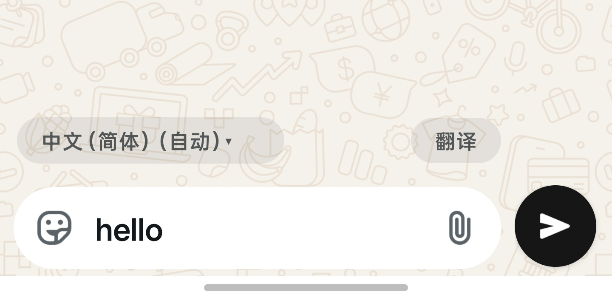

# WhatsApp 翻译助手

面向 WhatsApp 的 Xposed 翻译模块。将聊天消息翻译为指定语言，译文以小字形式显示在原文下方，颜色与字号可调。

模块不提供账号体系，亦不架设服务器。译文由公开接口或用户自行配置的 AI 接口生成，文本仅发送至所选引擎。

> 非官方第三方模块，与 Meta 无关联。第三方组件与数据来源见 [THIRD-PARTY.md](THIRD-PARTY.md)。

---

## 功能

- 支持 569 种语言，译文显示在原文下方
- 内置 4 个无需密钥的公开翻译引擎，另有 4 个需自填账号的引擎
- 支持任意 OpenAI 兼容接口，系统提示词可自定义
- 译文颜色、字号、斜体可分别调整
- 输入框上方提供语言与翻译两个按钮，用于将草稿译为目标语言
- 依据对方号码的国家代码离线查表，发消息时自动选用对方语言
- 消息翻译与输入框翻译可分别指定引擎
- 主题支持跟随系统、浅色、深色三种模式

---

## 截图

左侧为消息翻译效果与输入框翻译按钮，右侧为设置界面。

输入框上方的语言与翻译按钮：

---

## 环境要求

- 已获取 root 权限的 Android 10（API 29）及以上设备
- **LSPosed 2.x**（API 101 及以上）

模块基于 Modern Xposed API 实现，不依赖已废弃的 `de.robv.android.xposed`。
管理器中不会出现「使用了已废弃且即将移除的功能」提示，亦不会随旧版 API 的移除而失效。

---

## 安装

1. 安装 APK
2. 在 LSPosed 的「模块」列表中启用 WhatsApp 翻译助手
3. 进入模块页面 →「作用域」→ 勾选 WhatsApp
   - 普通版：`com.whatsapp`
   - Business 版：`com.whatsapp.w4b`
4. 强制停止 WhatsApp 后重新启动

作用域已在模块中声明，管理器会将其列为推荐项，但仍需手动确认一次，不会自动生效。

---

## 翻译引擎

切换引擎后，界面展开该引擎所需的配置项。

| 引擎 | 密钥 | 说明 |
|---|---|---|
| Google 翻译 | 否 | 默认选项 |
| Google 翻译 · 备用通道 | 否 | 主通道异常时使用 |
| Bing 翻译 | 否 | |
| MyMemory 翻译记忆库 | 否 | |
| 百度翻译 | 是 | 需 AppID 与密钥 |
| DeepL | 是 | 以 `:fx` 结尾的密钥自动使用免费端点 |
| 微软翻译 | 是 | 可选 Region |
| 自定义 AI | 是 | 任意 OpenAI 兼容接口，端点可只填 base |

前四个引擎无需账号即可使用。

### 自定义 AI

自定义 AI 走对话式接口，支持三种 API 格式：OpenAI Chat Completions、OpenAI Responses、
Anthropic Messages。格式与服务端不匹配时请求返回 404；默认选项适用于绝大多数服务与第三方中转站。

端点地址可填至 `/v1`、填完整路径，或仅填域名，三种写法均可识别。

配置界面提供两项辅助功能：

- **拉取模型列表**：向接口请求当前密钥可用的模型，选定后自动填入模型名。
  若返回 403 `Access to model denied`，表示该密钥未被授权使用所请求的模型，
  需在服务商或中转站后台将其加入令牌允许列表。
- **测试连接**：发送一次探测请求，输出 HTTP 状态码与已尝试的地址。
  404 表示地址或格式不匹配，401 表示密钥无效，400 表示模型名有误。

### 系统提示词

自定义 AI 先发送系统提示词，再发送待翻译文本。`${toCode}` 替换为目标语言代码，
默认值见 `Translators.DEFAULT_AI_PROMPT`，可自行修改。

系统提示词为必需项。若不发送，部分通用对话模型不会执行翻译，而是将输入视为普通提问。
默认提示词包含三条规则，分别用于抑制说明性前缀、保持段落结构、保留不应翻译的专有名词与代码。
这些规则对较新的模型影响有限，主要作用在于对较弱模型与复杂格式文本提供保障。

提示词随每条消息发送，且仅对自定义 AI 生效——其余引擎并非对话式接口。

---

## 语言与对方信息

- **译文语言**：内置 569 种，可按中文名或英文名搜索
- **对方信息**：打开会话时依据对方号码的国家代码离线查表，得出国家、语言、货币与当地时间

查表全程在本地完成，不发起网络请求，号码亦不参与翻译请求。

查得的对方语言用于两处：翻译草稿时（点击「翻译」或长按发送键）自动选用对方语言；
翻译完成后，提示信息中注明对方的国家与当地时间，例如 `+55 巴西 · 葡萄牙语 · BRL R$ · 09:32`。

群聊与号码隐藏的会话不存在单一国家，此时使用设置中指定的语言。

---

## 输入框翻译

在聊天框中输入文本后，点击输入框上方的「翻译」，草稿将被替换为目标语言译文；
此时点击发送键发送的是译文。再次点击「翻译」可还原为原文，原文不会丢失；
若在译文状态下继续编辑，模块不会覆盖新输入的内容。

长按发送键与点击「翻译」等效。

左侧按钮用于选择目标语言。默认为跟随对方语言；群聊与号码隐藏的会话无法判定，
此时使用设置中指定的语言。

消息翻译与输入框翻译的语言分别配置：前者作用于收到的消息，后者作用于发出的内容。
两者亦可分别指定引擎，默认保持一致。

---

## 收发两个方向

译文渲染的判定依据是消息视图本身，而非消息方向，因此发出的消息同样显示译文，
可用于核对发送内容是否准确。译文与原文相同时跳过，不重复显示。

---

## 隐私

- 仅申请 `INTERNET` 与 `ACCESS_NETWORK_STATE` 权限
- 仅 hook `com.whatsapp` 与 `com.whatsapp.w4b` 两个包
- 网络请求仅由所选引擎发起：使用公开引擎时文本发送至对应服务，使用自填引擎时仅发送至自行配置的端点
- 无账号体系，无统计上报；模块不架设服务器，不将文本发送至所选引擎之外的任何位置
- 对方信息由国家代码离线查表得出，查表不发起网络请求，号码不参与翻译请求
- API 密钥以明文保存于本机应用私有目录，不上传，不写入日志

---

## 常见问题

**译文未出现**

在 Xposed 日志中搜索 `LSTrans`。日志记录所用端点、HTTP 状态码与接口返回内容，
可据此区分接口不可用与配置有误。公开引擎依赖对应服务的可用性，服务状态可能随时间变化。

**聊天列表的预览未翻译**

此为有意设计。列表预览使用不同的 view ID，翻译会造成刷屏。

**作用域如何选择**

勾选本机已安装的版本。普通版与 Business 版为两个独立的包，两者均安装时需同时勾选。
作用域中包含未安装的包会导致设置报错。

**提示框架版本不满足**

模块需要 LSPosed 2.x（API 101 及以上）。在仅支持旧版 API 的框架上，模块不会被加载。

**修改译文颜色或字号后未立即生效**

样式变更会触发已有消息重绘。若个别消息未随之更新，退出会话后重新进入即可。

---

## 开发

构建方式、工作原理与发布流程见 [docs/DEVELOPMENT.md](docs/DEVELOPMENT.md)。

---

## 许可

代码采用 [GPL-3.0](LICENSE)。

第三方组件与数据来源的署名见 [THIRD-PARTY.md](THIRD-PARTY.md)：Unicode CLDR（Unicode License）、libphonenumber（Apache-2.0）、Xposed API（Apache-2.0）。
