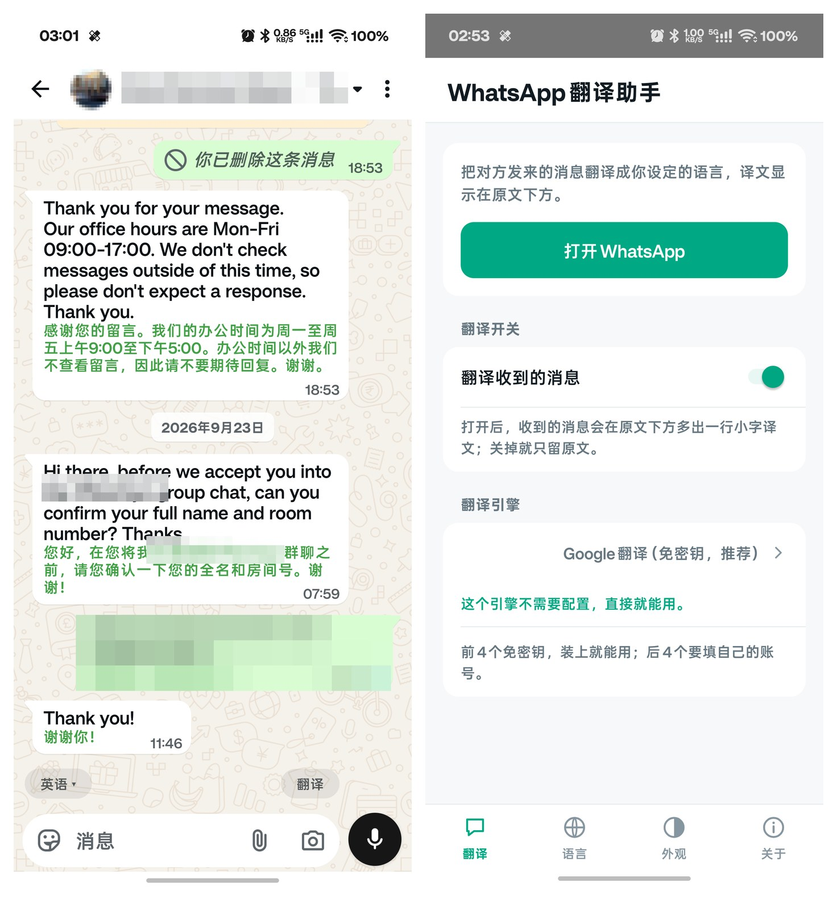

# WhatsApp 翻译助手

面向 WhatsApp 的 Xposed 翻译模块。把聊天消息翻译成你设定的语言，译文以小字显示在原文下方，颜色和字号都能自己调。

无需注册或登录，模块自己也不架设服务器；翻译走公开接口或你自己配置的 AI 接口——你选了哪个引擎，文本就发给谁。

> 非官方第三方模块，与 Meta 无关联。第三方组件与数据来源见 [THIRD-PARTY.md](THIRD-PARTY.md)。

---

## 功能

- 将消息翻译为 569 种语言中的任意一种，译文显示在原文下方
- 4 个无需密钥的公开翻译引擎，另有 4 个支持自填账号的引擎
- 支持任意 OpenAI 兼容的 AI 接口，可自定义系统提示词
- 译文颜色、字号、是否斜体可调
- 根据对方号码的国家代码离线查表，得到国家、语言、货币与当地时间
- 长按发送键，把输入框里打的字翻译成目标语言，再长按一次还原

---

## 截图

左侧为翻译效果，右侧为设置界面。

---

## 环境要求

- 已 root 的 Android 10（API 29）及以上设备
- **LSPosed 2.x**（API 101 及以上）

本模块基于 Modern Xposed API 编写，不依赖已废弃的 `de.robv.android.xposed`。
因此在管理器里不会出现「使用了已废弃且即将移除的功能」提示，也不会随旧 API 被移除而失效。

---

## 安装

1. 安装 APK
2. LSPosed → **模块** → 启用 **WhatsApp 翻译助手**
3. 进入模块页面 → **作用域** → 勾选 WhatsApp
   - 普通版：`com.whatsapp`
   - Business 版：`com.whatsapp.w4b`
4. 强制停止 WhatsApp 后重新打开

作用域在模块里声明过，管理器会把它列为推荐项，但**仍需确认一次**，不会自动生效。

---

## 翻译引擎

切换引擎后，界面会自动展开该引擎所需的配置项。

| 引擎 | 密钥 | 说明 |
|---|---|---|
| Google 翻译 | 否 | 默认选项 |
| Google 翻译 · 备用通道 | 否 | 主通道异常时使用 |
| Bing 翻译 | 否 | |
| MyMemory 翻译记忆库 | 否 | |
| 百度翻译 | 是 | 需 AppID 与密钥 |
| DeepL | 是 | 以 `:fx` 结尾的密钥自动使用免费端点 |
| 微软翻译 | 是 | 可选 Region |
| 自定义 AI | 是 | 任意 OpenAI 兼容接口，端点可只填 base |

前四个无需任何账号即可使用。

### 自定义 AI 的系统提示词

自定义 AI 引擎会先发送一条系统提示词，再发送待翻译文本。`${toCode}` 会被替换为目标语言代码，
默认值见 `Translators.DEFAULT_AI_PROMPT`，可以自行修改。

系统提示词是必需的：若完全不发送，部分通用对话模型不会执行翻译，而是把输入当作待处理的
普通提问。默认提示词含三条规则，分别用于抑制多余的说明性前缀、保持段落结构、保留不应
翻译的专有名词与代码。这三条对较新的模型影响有限，主要价值在于对较弱模型和复杂格式文本
提供保障。

提示词随每条消息发送，且仅对自定义 AI 引擎生效——其余引擎不是对话式接口。

---

## 语言与对方信息

- **译文语言**：内置 569 种，可按中文名或英文名搜索
- **对方信息**：根据对方号码的国家代码离线查表，得出国家、语言、货币与当地时间

查表全在本地完成，不发网络请求，号码也不参与翻译请求。

---

## 输入框翻译

在聊天框里用自己习惯的语言打好字，**长按发送键**，草稿就会变成译文；这时单击发送键，
发出去的就是译文。

**长按第二次可以还原成你原本写的原文**，一个字都不会丢。若译文还没换回来你就继续打字了，
模块不会覆盖你新打的内容。

这个动作不会自动发送，也不会在界面上多出任何按钮或浮窗——用的是发送键本来就有的长按，
所以聊天界面里看不出多出任何东西。

「翻译成什么语言」在设置里单独配置（默认英语），和上面那个「把别人消息翻译成什么语言」
是两回事：上面管收，这里管发。

---

## 收发两个方向

过滤依据是消息视图本身，而不是消息方向，因此**你发出的消息也会显示译文**——这样可以立刻
确认自己发出去的内容是否准确。当译文与原文相同时会跳过，不会重复显示。

---

## 隐私

- 仅申请 `INTERNET` 与 `ACCESS_NETWORK_STATE` 权限
- 仅 hook `com.whatsapp` 与 `com.whatsapp.w4b` 两个包
- 唯一的网络行为由所选引擎决定：使用公开引擎时文本发送至对应服务，使用自填引擎时仅发送至自行配置的端点
- 无账号、无统计上报；模块自身不架设服务器，也不把文本发往所选引擎之外的任何地方
- 对方信息由国家代码离线查表得出，号码不参与翻译请求

---

## 常见问题

**译文没有出现**

在 Xposed 日志中搜索 `LSTrans`。日志会记录所用端点、HTTP 状态码与接口返回内容，可据此判断
是接口不可用还是配置有误。公开引擎依赖对应服务的可用性，长期可能发生变化。

**聊天列表的预览没有翻译**

这是有意为之。列表预览使用不同的 view ID，翻译它会造成刷屏。

**作用域怎么选**

装着哪个就勾哪个。普通版与 Business 版是两个不同的包，两个都装就都勾。
注意作用域里若包含本机未安装的包，设置会直接报错。

**提示框架版本不满足**

模块需要 LSPosed 2.x（API 101 及以上）。在只支持旧版 API 的框架上模块不会被加载。

---

## 开发

构建方式、工作原理与发布流程见 [docs/DEVELOPMENT.md](docs/DEVELOPMENT.md)。

---

## 许可

代码采用 [GPL-3.0](LICENSE)。

第三方组件与数据来源的署名见 [THIRD-PARTY.md](THIRD-PARTY.md)：Unicode CLDR（Unicode License）、libphonenumber（Apache-2.0）、Xposed API（Apache-2.0）。
